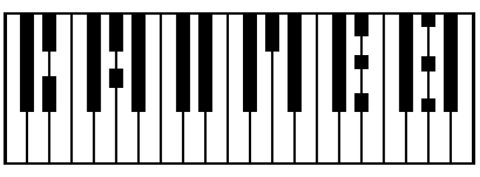

<p align="center">
  
</p>

[](https://github.com/antoniovazquezaraujo/carmen/actions/workflows/ci.yml)
[](https://antoniovazquezaraujo.github.io/carmen/)
[](https://antoniovazquezaraujo.github.io/carmen/app/)

# Carmen

*Carmen* is an unusual sequencer with algorithmic capabilities. It is built on a musical programming language in which music is expressed through **`.mr`** documents (Music Representation) that describe musical harmony with extraordinary concision.

The web version of *Carmen* lets you create music and listen to it online, while the `carmen` command compiles an **`.mr`** file it generates (and that the user can modify freely) and converts it to MIDI, the most widely used fully open music description format.

Broadly speaking, instead of describing a melody directly, note by note, *Carmen* lets you specify the core notes of the melody and have the system add or modify notes to form harmonic structures. The same applies to arpeggios, bass lines, chords and patterns. It uses no notation beyond the numbering of the notes—though they are not really notes, but scale degrees. This gives impressive flexibility for modulations and experiments of every kind. The scales used are the most common in Western harmony, although they are not called by the same names; they have simpler names and a very clear graphical representation.

*Carmen* is the practical side of **Particle Music** (*Música de partículas*), a framework that explains harmony from mathematical structure and perception rather than tonal conventions. It attempts to separate music from people—that is, to remove every human influence from music: fashions, traditions, styles, methods and mechanisms that people have added to music throughout history. The idea is to take only the mathematical part of music and take absolutely nothing for granted.

The goal is to show that music "works" by itself, without any human having to judge by ear whether something sounds more or less pleasant. Music works "in spite of" us, and the truth is that it is not a human invention but a discovery. Most of the techniques used to tell stories through music were already there; they only had to be used. And no: a major chord will never sound sad, nor a minor chord happy, even if musical fashions turn the world upside down. It is not possible, because music has a real foundation, as explained in [Particle Music](https://github.com/antoniovazquezaraujo/particle-music).

## Play in the browser

The current web build runs at **<https://antoniovazquezaraujo.github.io/carmen/app/>**; no installation required. The user documentation stays at the site root.

## Quickstart

Requires **Node 22** (for example via nvm) and npm 10.

```sh
export PATH="$HOME/.nvm/versions/node/v22.23.3/bin:$PATH"   # Node 22 via nvm

npm ci        # install dependencies
npm start     # run the app on http://localhost:4200
npm test      # Jest suite (core, no browser)
npm run build # production build
```

Or just `./scripts/dev.sh`: it sets up Node 22, runs `npm ci` when `node_modules` is missing and then starts the dev server.

## MIDI compiler (experimental)

The repository ships a browser-free CLI, `carmen`, that compiles a `.mr` song to a Standard MIDI File. It is published on npm as `carmen-cli`:

```sh
npm install -g carmen-cli

carmen compile cancion.mr              # writes cancion.mid
carmen compile cancion.mr -o salida.mid
carmen compile cancion.mr --json       # inspect the compiled events
carmen check cancion.mr                # validate without generating output
carmen version
```

You can also build and run it from a clone:

```sh
npm run build:cli
node packages/compiler/dist/cli/main.js compile cancion.mr
node packages/compiler/dist/cli/main.js check cancion.mr
node packages/compiler/dist/cli/main.js version
cat cancion.mr | node packages/compiler/dist/cli/main.js compile - -o salida.mid
```

`npm run midi -- cancion.mr` remains a development shortcut (it builds the CLI first). The CLI exposes a single `carmen` binary with `compile`, `check`, `version` and `help`. The compiler uses the same playback semantics as the app (parts, structural blocks, content libraries, repeats, settings, operations, patterns, chords and arpeggios). MIDI is not audio: open the `.mid` in a DAW or render it with a synthesizer such as FluidSynth. See [`docs/developer/analysis/compilador-midi-mvp.md`](docs/developer/analysis/compilador-midi-mvp.md) for the current limitations.

## The `.mr` language

A minimal song:

```mr
song Semilla
version 2

melodies
  melody Origen
    notes
      4n:0
      4n:2
      4n:4
      4n:2

part Piano
  block Origen
    melody Origen
```

Edit it in the GUI, in the advanced text view (`.mr` button) or with any editor; songs are saved and loaded as `.mr` files (UTF-8/LF, no volatile ids, git-diff friendly). Every complete example in the manual is validated on each `npm test`.

## Documentation

- 🎹 **[Web app](https://antoniovazquezaraujo.github.io/carmen/app/)** — run the current web build in the browser.
- **[Particle Music](https://github.com/antoniovazquezaraujo/particle-music)** — theoretical foundation.
- 🌐 **[User documentation](https://antoniovazquezaraujo.github.io/carmen/)** — language manual, syntax cheatsheet and usage guide.
- 📘 **[`.mr` language manual](docs/user/manual.md)** — full reference (also on the published site).
- 🧑‍💻 **[Developer wiki](docs/developer/README.md)** — architecture, ADRs, analysis, audits, design and release process (in Spanish).
- ✅ **[Manual validation v1](docs/developer/testing/validacion-manual-v1.md)** — step-by-step checklist.
- 🗒️ **[Changelog](CHANGELOG.md)** — changes per version.
- 🤝 **[Contributing](CONTRIBUTING.md)** — branch workflow, PRs and conventions.
- 💚 **(Neo)Vim support](editors/nvim/README.md)** — `ftdetect`, `syntax` and `ftplugin` for `.mr`.

## Workflow (summary)

- `develop` is the integration branch (protected): work happens in `feature/...` or `fix/...` branches and **PRs**.
- `main` reflects released versions; deployments are triggered with a `v*` tag (see [`docs/developer/release/Release_Process.md`](docs/developer/release/Release_Process.md)).
- CI (`tests + build`) is required on every PR and coverage has its own threshold.
- User documentation is published automatically on every push to `develop`.
- The web app is published under `/app/` when a `v*` tag is pushed (or manually with `workflow_dispatch`).

## Project layout

| Path | Content |
|---|---|
| `packages/core/src/mr/` | Parser, serializer, errors and the `.mr` contract. |
| `src/app/model/mr/__tests__/corpus/` | Canonical `.mr` songs used by the tests. |
| `packages/core/` | Pure model, `.mr` parser/serializer and note generation (no Angular/Tone). |
| `packages/compiler/src/` | Browser-free `.mr` → MIDI compiler and CLI. |
| `src/app/components/` | GUI (song editor, parts, blocks, content library, melody editor, `.mr` view). |
| `docs/user/` | Public documentation (published to GitHub Pages). |
| `docs/developer/` | Internal wiki: ADR, analysis, audits, design, release (Spanish). |
| `editors/nvim/` | Opt-in syntax/indent plugin for `.mr`. |

## License

[Apache-2.0](LICENSE).
