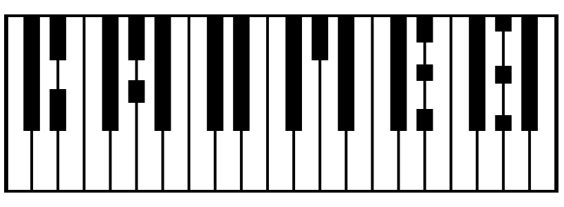

<p align="center">
  
</p>

[🇬🇧 Read in English](README.md)
# Carmen

Estudio de armonía con GUI de componentes (partes, bloques, editor de melodía) y un formato de texto canónico, **`.mr`**, para guardar y cargar canciones. El texto es la representación canónica de la canción; la GUI es su vista guiada.

[](https://github.com/antoniovazquezaraujo/carmen/actions/workflows/ci.yml)
[](https://antoniovazquezaraujo.github.io/carmen/)
[](https://antoniovazquezaraujo.github.io/carmen/app/)

Estado: **lenguaje `.mr` v2** (2026-11-05, `version 2`). El formato 2 añade bibliotecas globales `melodies`, `presets` y `procedures`; los bloques son estructurales y referencian ese contenido.

## Por qué nace Carmen

Carmen es la parte práctica de **Música de partículas**, un marco que explica la armonía desde la estructura matemática y la percepción, no desde las convenciones tonales. El documento explica de dónde salen las escalas y las partículas, por qué la app se organiza así y por qué este modelo no está pensado para escribir música tonal «normal».

Si el sistema de notas te resulta nuevo, empieza por el documento:

- [Repositorio de Música de partículas](https://github.com/antoniovazquezaraujo/particle-music)
- [Descargar el último PDF (español e inglés)](https://github.com/antoniovazquezaraujo/particle-music/releases/latest)

## Probar en el navegador

La build web actual está publicada en **<https://antoniovazquezaraujo.github.io/carmen/app/>**; no hace falta instalar nada. La documentación de usuario sigue en la raíz del sitio.

## Quickstart

Requiere **Node 22** (por ejemplo con nvm) y npm 10.

```sh
export PATH="$HOME/.nvm/versions/node/v22.23.3/bin:$PATH"   # Node 22 vía nvm

npm ci        # instala dependencias
npm start     # arranca la app en http://localhost:4200
npm test      # suite Jest (núcleo, sin navegador)
npm run build # build de producción
```

## El lenguaje `.mr`

Una canción mínima:

```mr
song Semilla
version 2

melodies
  melody Origen
    notes
      4n:0
      4n:2
      4n:4
      4n:2

part Piano
  block Origen
    melody Origen
```

Se edita en la GUI, en la vista avanzada de texto (botón `.mr`) o con cualquier editor; se guarda y se carga como fichero `.mr` (UTF-8/LF, sin ids volátiles, apto para diffs de git). Los ejemplos completos de la guía se validan en cada `npm test`.

## Documentación

- 🎹 **[Aplicación web](https://antoniovazquezaraujo.github.io/carmen/app/)** — ejecuta la build web actual en el navegador.
- 🌐 **[Documentación de usuario](https://antoniovazquezaraujo.github.io/carmen/)** — manual del lenguaje, chuleta de sintaxis y guía de uso.
- 📘 **[Manual del lenguaje `.mr`](docs/user/manual.md)** — referencia completa (también en el sitio publicado).
- 🧑‍💻 **[Wiki de desarrollo](docs/developer/README.md)** — arquitectura, ADRs, análisis, auditorías, diseño y proceso de release.
- ✅ **[Validación manual v1](docs/developer/testing/validacion-manual-v1.md)** — checklist paso a paso.
- 🗒️ **[Changelog](CHANGELOG.md)** — cambios por versión.
- 🤝 **[Contribuir](CONTRIBUTING.md)** — flujo de ramas, PRs y convenciones.
- 💚 **[Soporte (Neo)Vim](editors/nvim/README.md)** — `ftdetect`, `syntax` y `ftplugin` para `.mr`.

## Flujo de trabajo (resumen)

- `develop` es la rama de integración (protegida): se trabaja con ramas `feature/...` o `fix/...` y **PRs**.
- `main` refleja las versiones publicadas; los despliegues se lanzan con un tag `v*` (ver [`docs/developer/release/Release_Process.md`](docs/developer/release/Release_Process.md)).
- El CI (`tests + build`) es obligatorio en cada PR y la cobertura tiene umbral propio.
- La documentación de usuario se publica sola al hacer push a `develop`.
- La aplicación web se publica en `/app/` al empujar un tag `v*` (o manualmente con `workflow_dispatch`).

## Estructura rápida

| Ruta | Contenido |
|---|---|
| `src/app/model/mr/` | Parser, serializador, errores, fichero y contrato del `.mr`. |
| `src/app/model/mr/__tests__/corpus/` | Canciones `.mr` canónicas usadas por los tests. |
| `src/app/components/` | GUI (song-editor, parts, blocks, biblioteca de contenido, melody-editor, vista `.mr`). |
| `docs/user/` | Documentación pública (se publica en GitHub Pages). |
| `docs/developer/` | Wiki interna: ADR, análisis, auditorías, diseño, release. |
| `editors/nvim/` | Plugin opt-in de resaltado/indentación para `.mr`. |

## Licencia

[Apache-2.0](LICENSE).
